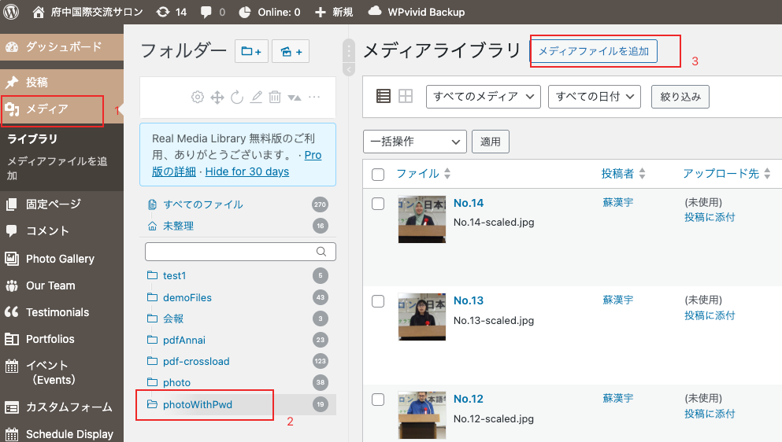
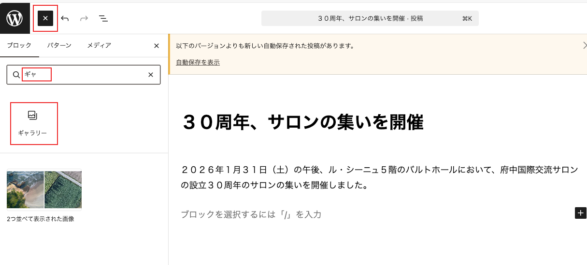
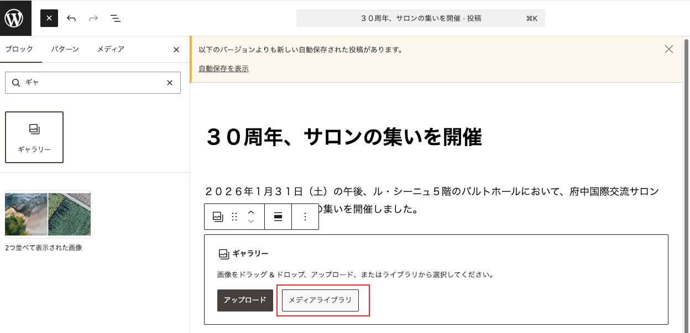
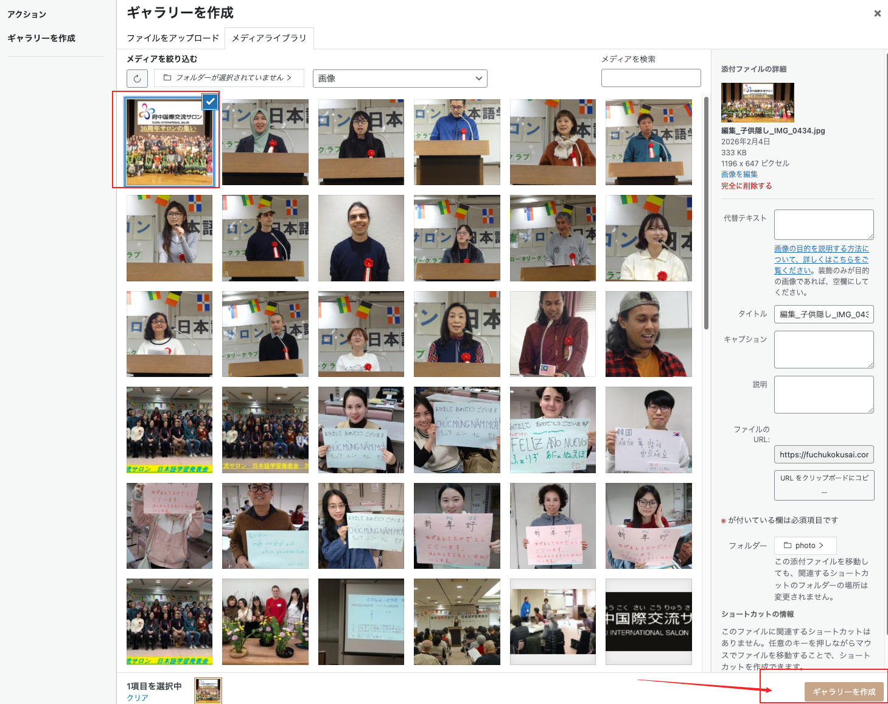
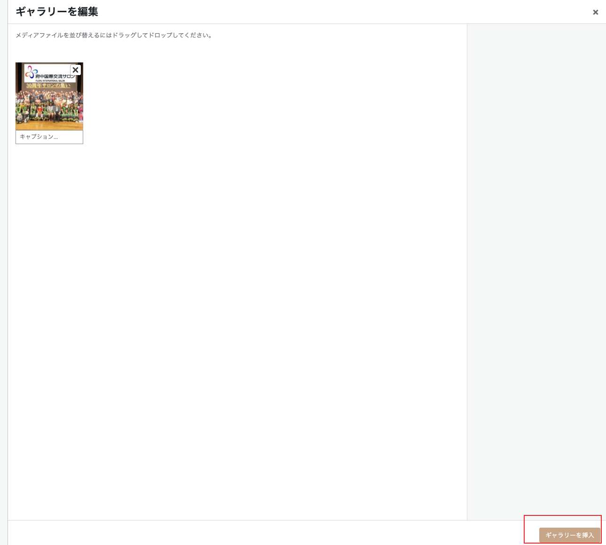
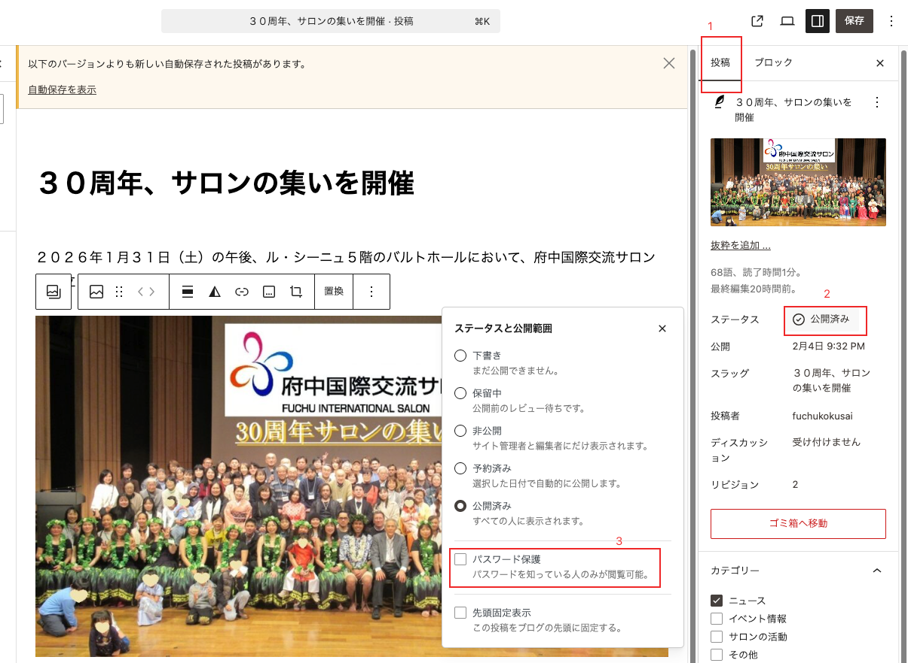
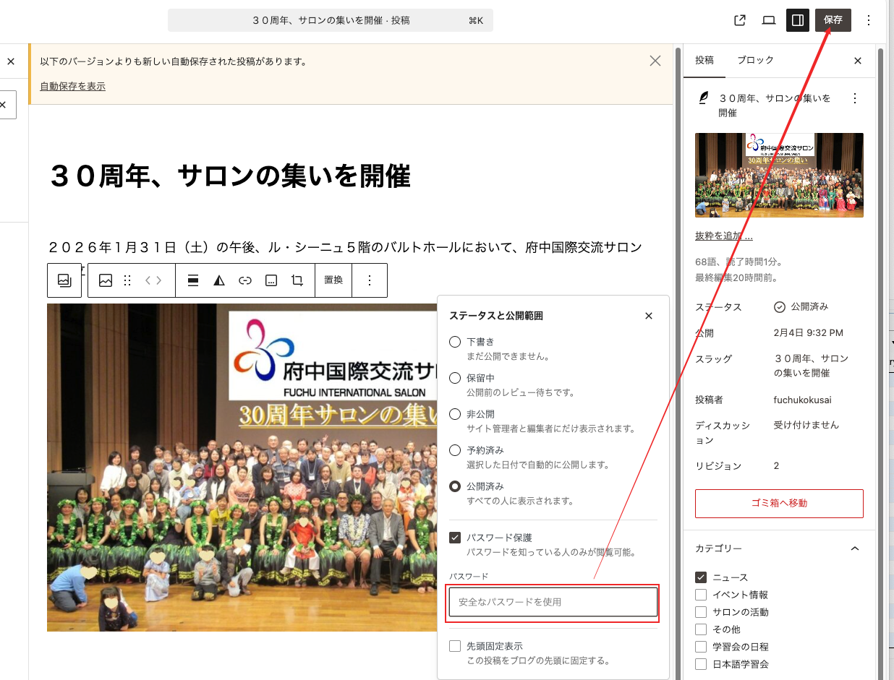
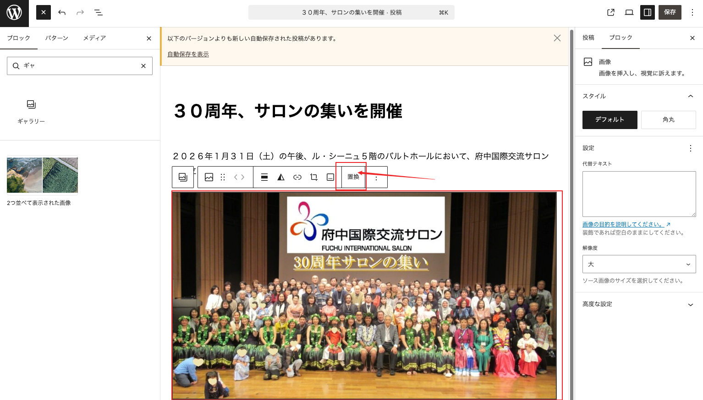
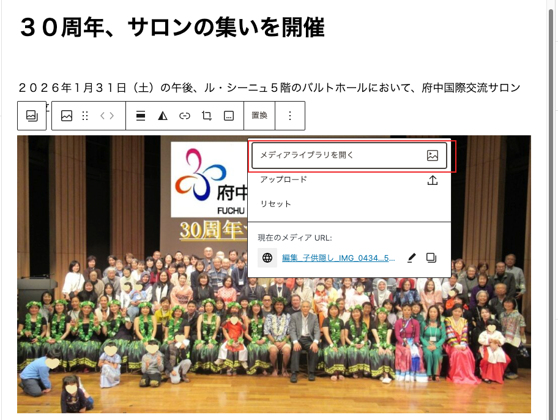

パスワード付きのギャラリーページを作成するには、事前に画像を「メディア」の「photoWithPwd」フォルダにアップロードしてください。以下のとおりです。

「投稿」ページに入り、ページ内に「ギャラリー」を追加します。

ボタンをクリックし、画像を選択します。

画像を選択後、「ギャラリーを作成」ボタンをクリックして確定します。

「ギャラリーを挿入」ボタンをクリックします。

公開範囲を選択し、「パスワード保護」にチェックを入れます。

パスワードを入力し、「保存」ボタンをクリックすれば完了です。

## 画像の変更

すでに「ギャラリー」を追加している場合でも、画像を変更したい場合は以下の手順を参照してください。

画像を選択すると「置換」メニューが表示されるので、クリックします。

「メディアライブラリを開く」ボタンを選択します。

その後、メディアライブラリから必要な画像を選択できます。
